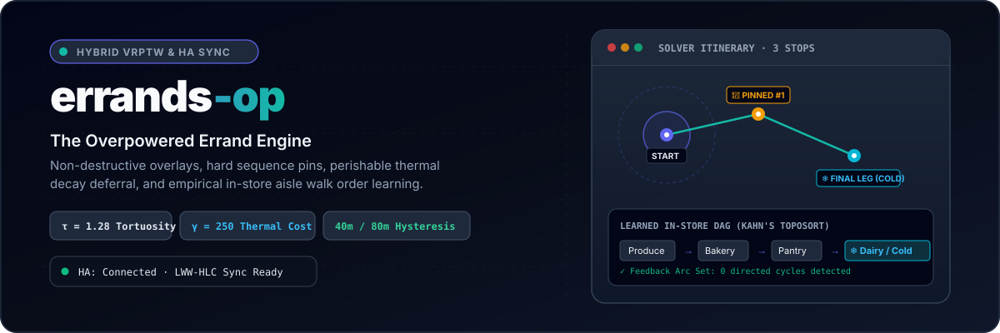
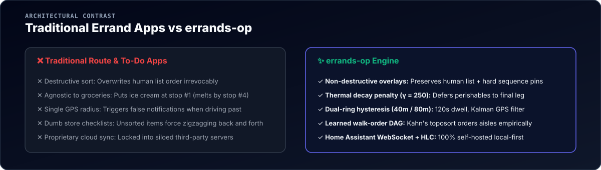
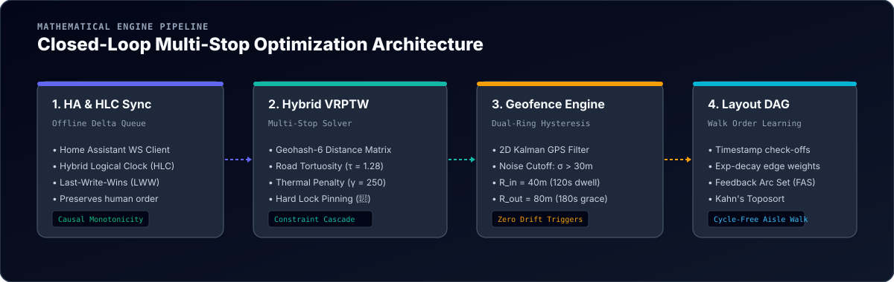

<p align="center">
  
</p>

<p align="center">
  <a href="https://flutter.dev"></a>
  <a href="https://dart.dev"></a>
  <a href="https://opensource.org/licenses/MIT"></a>
  <a href="https://github.com/seeramsujay/errands-op"></a>
  <a href="https://www.home-assistant.io"></a>
</p>

<p align="center">
  <b>errands-op</b> is an offline-first, algorithmic errand routing engine. It bridges Home Assistant to-do lists, solves multi-stop Vehicle Routing Problems with Time Windows (VRPTW), prevents false GPS triggers with dual-ring hysteresis geofencing, and learns in-store aisle walk-orders through Feedback Arc Set cycle elimination and topological sorting.
</p>

---

## ⚡ Why errands-op?

Most errand organizers either force-sort your personal list into an unfamiliar sequence or ignore the practical realities of shopping—such as frozen groceries melting while you visit the hardware store, or GPS bouncing while driving by a plaza.

<p align="center">
  
</p>

---

## 🏗️ System Architecture

`errands-op` executes a closed-loop four-stage mathematical pipeline:

<p align="center">
  
</p>

### 1. Home Assistant Sync & Hybrid Logical Clocks
- Bi-directional sync connecting directly to Home Assistant's `/api/websocket` subscribing to `todo/` items.
- Offline-first delta mutation queue utilizing monotonic **Hybrid Logical Clocks (HLC)** and **Last-Write-Wins (LWW)** conflict resolution.
- Exponential backoff with random jitter to gracefully handle intermittent network availability.

### 2. Hybrid VRPTW Multi-Stop Sequence Solver
- **Disjunctive Candidate Matching**: Automatically links errand items to stores that support their category, weighted by historical store preference confidence.
- **Geohash-6 Distance Matrix**: 6-character spatial caching with 7-day TTL and road tortuosity factor ($\tau = 1.28$). Recalculation is skipped unless user displacement exceeds $500\text{m}$.
- **Human Hard Sequence Locks**: Pin (📌) any stop to enforce immutable sequence constraints ($t_A + s_A + C_{AB} \le t_B$).
- **Thermal Decay Penalty**: Perishable cold items incur a dynamic penalty ($\gamma = 250$), automatically deferring their stores to the final leg of your trip.
- **Constraint Relaxation Cascade**: If a hard lock conflicts with store operating hours, the engine surfaces an explicit warning banner rather than silently failing.

### 3. Dual-Ring Hysteresis Geofencing State Machine
- **2D Kalman GPS Filter**: Discards noisy fixes with horizontal accuracy $\sigma > 30\text{m}$.
- **Inner Arrival Ring ($R_{\text{in}} = 40\text{m}$)**: Requires continuous $120\text{s}$ dwell before transitioning to `INSIDE_STORE` mode.
- **Outer Exit Ring ($R_{\text{out}} = 80\text{m}$)**: Provides an exit grace buffer of $180\text{s}$ to prevent premature session termination when walking through store dead zones.

### 4. Learned In-Store Layout Walk-Order (DAG)
- Observes real timestamped item check-offs inside stores ($\tau_1 < \tau_2 < \dots < \tau_m$).
- Computes exponential decay precedence weights: $w(\Delta \tau) = \exp(-(\tau_B - \tau_A)/\sigma)$.
- **Feedback Arc Set (FAS)**: Breaks directed cycles by severing the weakest links.
- **Kahn's Topological Sort**: Produces an empirical walk order through store aisles, minimizing shopping transit time.

---

## 📱 Application Screens

| Screen | Responsibility |
| :--- | :--- |
| **Main Errand List** | Reorderable list preserving manual sequence, non-destructive overlay badges (`Stop #1`, `Stop #2`), filter chips, and "I'm Going Out" solver CTA. |
| **Route Itinerary** | Step-by-step timeline with arrival estimates, closing hour conflict alerts, and travel distances. |
| **Radar Map** | Interactive radar canvas rendering GPS fix, store nodes, route polylines, and dual geofence rings ($40\text{m} / 80\text{m}$). |
| **In-Store Shopping Mode** | Auto-triggered upon geofence dwell. Groups items by store aisle and sorts them via the learned DAG toposort. |
| **Settings & Simulator** | Home Assistant connection settings and a simulation sandbox to trigger mock GPS coordinates, geofences, and WebSocket sync. |

---

## 🚀 Quick Start

### Prerequisites
- [Flutter SDK](https://flutter.dev) (v3.13.0+)
- Dart SDK (v3.13.0+)

### Setup & Run
```bash
# Clone the repository
git clone https://github.com/seeramsujay/errands-op.git
cd errands-op

# Fetch dependencies
flutter pub get

# Run test suite
flutter test

# Run application on Linux desktop or connected mobile device
flutter run
```

---

## 🧪 Algorithmic Test Suite

All 10 unit and widget tests pass deterministically:

```bash
flutter test
# 00:11 +10: All tests passed!
# - test/vrp_solver_test.dart (Thermal decay deferral, hard sequence locks, closing hours cascade)
# - test/layout_learning_test.dart (Kahn's topological sort, Feedback Arc Set cycle removal)
# - test/geofence_engine_test.dart (Kalman filter thresholding, 40m arrival hysteresis)
# - test/sync_engine_test.dart (HLC monotonic clock ordering, mutation queue draining)
# - test/widget_test.dart (Non-destructive overlay badges, pins, checkoffs)
```

---

## 📄 License

Distributed under the MIT License. See [LICENSE](LICENSE) for more details.
